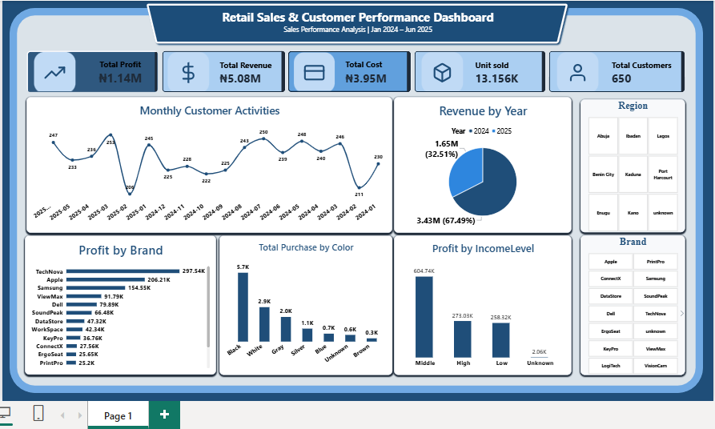

# Retail Sales & Customer Performance Analysis

## Project Overview

This project analyses retail sales and customer transaction data to evaluate business performance, understand customer purchasing patterns, identify product and brand profitability trends, and develop actionable business recommendations.

The analysis was carried out using **Microsoft Excel and Power BI**, with a focus on transforming raw data into meaningful business insights that can support data-driven decision-making.

> **Dataset note:** This is a synthetic portfolio dataset created for analytical practice and demonstration. The figures presented are illustrative and do not represent the actual financial performance of a real company.

## Business Objectives

The project seeks to:

- Evaluate overall sales, cost, profit, and profit margin.
- Identify the most and least profitable product brands.
- Examine customer performance across income segments.
- Analyse product demand by colour.
- Explore monthly customer activity and sales patterns.
- Translate analytical findings into practical business recommendations.

## Tools and Technologies

| Tool | Application |
|---|---|
| Microsoft Excel | Data inspection, cleaning, preparation, and initial analysis |
| Power Query | Data transformation and standardisation |
| Microsoft Power BI | Data modelling, DAX calculations, visualisation, and dashboard development |

## Project Dataset

The dataset contains sales transactions, customer information, and product details.

The analytical model includes:

- **Sales table:** Transaction-level sales records.
- **Customers table:** Customer attributes and income segments.
- **Products table:** Product and brand information.

The dataset covers the period from January 2024 to June 2025.

## Analytical Methodology

1. **Data inspection:** Reviewed the source workbooks and identified data-quality issues.
2. **Data cleaning:** Standardised inconsistent text values, reviewed missing records, and prepared the tables for analysis.
3. **Data modelling:** Structured the sales, customers, and products tables for Power BI analysis.
4. **DAX calculations:** Developed measures for revenue, cost, profit, and profit margin.
5. **Dashboard development:** Created interactive visualisations to communicate business performance.
6. **Business interpretation:** Identified key trends and developed recommendations based on the available data.

## Power BI Dashboard Preview

The dashboard provides an interactive overview of retail sales performance, profitability, customer segments, product performance, and sales trends.




## Project Deliverables

The following documents provide further details about the analysis:

1. [Client Insights and Business Recommendations](retail_sales_client_insights_recommendations.pdf)
2. [Technical Documentation](retail_sales_supporting_technical_documentation.pdf)
3. [Business Insights Presentation](retail_sales_business_insights_presentation.pptx)


*All monetary figures are illustrative dataset values and are not denominated in a real-world currency.*

## Key Findings

- The business recorded an illustrative profit margin of 22.39%.
- TechNova emerged as the highest-profit identifiable brand.
- The Middle-income customer segment contributed the highest profit.
- Black was the highest-selling product colour, while Brown recorded the lowest unit sales.
- Monthly customer activity showed variation across the analysis period.

## Business Recommendations

1. **Improve profitability monitoring:** Evaluate brand-level margins and cost structures to identify opportunities for better profitability.
2. **Strengthen customer retention:** Develop targeted engagement strategies for valuable customer segments.
3. **Improve product planning:** Use product demand patterns to support inventory and purchasing decisions.
4. **Investigate low-performing products:** Review pricing, customer demand, and product positioning for weaker-performing brands and categories.
5. **Improve performance tracking:** Monitor monthly sales and customer activity using consistent reporting periods.

## Project Deliverables

- **Power BI Dashboard:** Visual analysis of retail sales and customer performance.
- **Client Insights and Recommendations:** Business-focused interpretation of findings.
- **Technical Documentation:** Supporting information on data preparation, modelling, KPI definitions, and data-quality limitations.
- **Business Insights Presentation:** Summary of the project's key findings and recommendations.

## Repository Structure

```text
Retail-sales-customer-performance-analysis/
│
├── data/
│
├── Reports/
│   ├── retail_sales_client_insights_recommendations.pdf
│   └── retail_sales_supporting_technical_documentation.pdf
│
├── Presentation/
│   └── retail_sales_business_insights_presentation.pptx
│
└── README.md
```

## Project Limitations

- The dataset is synthetic and intended for portfolio demonstration.
- Some source-data quality exceptions require further validation before certain records can be treated as fully reliable.
- The available data does not establish the causes of observed sales or profitability patterns.
- Recommendations are based on the available dataset and should be validated against additional business information before implementation.

## Conclusion

This project demonstrates the use of Excel, Power Query, and Power BI to transform retail transaction data into business-focused insights.

It highlights how data analytics can support sales performance monitoring, customer segmentation, product evaluation, and strategic business decision-making.

**Project Category:** Data Analytics | Business Intelligence | Retail Analytics

**Tools:** Microsoft Excel | Power Query | Power BI | DAX
